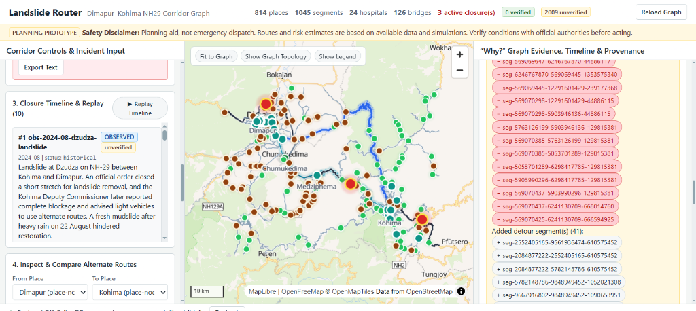
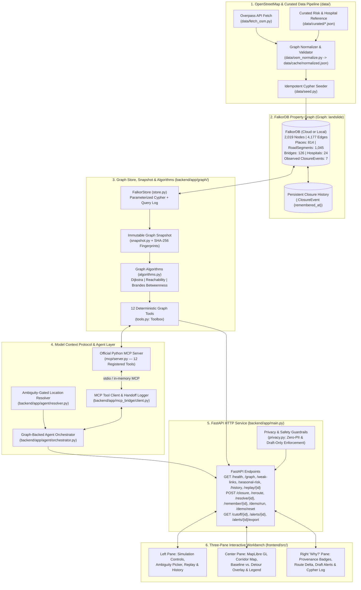

# Landslide Router

Graph-backed landslide-routing and impact-analysis workbench for the **Dimapur–Kohima corridor (NH29, Nagaland, India)**. Built with **FalkorDB**, **Model Context Protocol (MCP)**, **FastAPI**, and **React + MapLibre GL**.

> **Planning aid, not emergency dispatch.** Routes and risk estimates are based on available data and simulations. Verify conditions with official authorities before acting.



---

## Overview

During the June–September monsoon season, recurring landslides and rockfalls along National Highway 29 (NH29) disrupt connectivity between the Brahmaputra plains at **Dimapur** and the state capital **Kohima**, as well as surrounding hill villages in Kohima and Phek districts.

**Landslide Router** models the corridor as a property graph in **FalkorDB** (`2,019` real OpenStreetMap nodes and `4,177` relationships) and exposes deterministic graph algorithms through an official **Model Context Protocol (MCP)** server:

- **Ambiguity-Gated Location Resolution**: Natural-language closure reports are resolved against graph landmarks, highway refs, and bridge names. Ambiguous inputs return ranked candidate segments and require operator confirmation before mutating the graph.
- **Weighted Detour Routing & Baseline Comparison**: Computes shortest-travel-time paths around active closures and compares every segment against the unobstructed baseline route.
- **Reachability & Hospital Access Impact**: Identifies settlements newly isolated from Dimapur and evaluates hospital reachability across all `24` corridor medical facilities.
- **Structural Weak Links & Seasonal Risk**: Ranks critical single-point-of-failure segments and bridges using Brandes all-pairs shortest-path betweenness centrality combined with monsoon exposure and historical failure records.
- **Synthetic Draft Alerts & Audit Trail**: Generates reviewable draft community alerts (`status="draft"`, `sent=false`) and audits graph state against cryptographic SHA-256 baseline fingerprints upon closure resolution.

---

## Technical Architecture



---

## Quickstart (Windows Command Prompt)

### Prerequisites
- **Python 3.11+** (`py -3 --version`)
- **Node.js 20 LTS+** (`node --version`)
- **FalkorDB**: Either a free **FalkorDB Cloud** instance (recommended for 4 GB RAM laptops — zero local container overhead) or local **Docker Desktop**.

### 1. Configure `.env`

```bat
copy .env.example .env
```

Edit `.env` with your FalkorDB connection details:
- **FalkorDB Cloud (no Docker required)**: Set `FALKORDB_HOST`, `FALKORDB_PORT`, `FALKORDB_USERNAME`, `FALKORDB_PASSWORD`, and `FALKORDB_SSL=false` (or `true` if TLS is enabled on your cloud endpoint).
- **Local Docker**: Leave defaults (`FALKORDB_HOST=localhost`, `FALKORDB_PORT=6379`) and run `docker compose up -d`.

### 2. Seed the NH29 Graph into FalkorDB

The repository includes the validated OpenStreetMap NH29 corridor dataset at [`data/cache/normalized.json`](data/cache/normalized.json) (`2,019` nodes and `4,177` relationships). To seed (or verify) your FalkorDB instance:

```bat
cd backend
py -3 -m venv .venv
.venv\Scripts\activate.bat
python -m pip install -r requirements.txt
cd ..
python data\seed.py
```

*(Re-running `python data\seed.py` is idempotent and verifies that `0` duplicate nodes or relationships are created and all 24 graph invariant checks pass.)*

### 3. Start the Backend and Frontend

**Window 1 — FastAPI Backend (`http://127.0.0.1:8000`)**:

```bat
cd backend
.venv\Scripts\activate.bat
uvicorn app.main:app --host 127.0.0.1 --port 8000
```

**Window 2 — React + MapLibre Workbench (`http://localhost:5173`)**:

```bat
cd frontend
npm install
npm run dev
```

Open **http://localhost:5173** in your browser. Interactive OpenAPI documentation is available at **http://127.0.0.1:8000/docs**.

---

## Reproducible 3-Minute Demonstration & Clean Reset

### Automated 12-Step CLI Demonstration (~21 seconds)

Run all 12 demonstration steps end-to-end through the MCP tool bridge:

```bat
backend\.venv\Scripts\activate.bat

:: Against live FalkorDB (configured in .env):
python scripts\run_demo.py

:: Or offline against the cached 2,019-node OpenStreetMap NH29 dataset:
python scripts\run_demo.py --dataset data\cache\normalized.json
```

### The 12 Demonstration Steps & Verified Real-Graph Outputs

| Step | Action | Verified NH29 Graph Output |
|---|---|---|
| **1** | **Show corridor map & sourced road network** | Loads `nh29-dimapur-kohima` with **`814` places** (`93` villages, `10` towns, `711` junctions), **`1,045` road segments** (`294` on NH29 covering `189.521 km`), **`126` bridges**, **`24` hospitals**, and **`7` historical closures**. Baseline Dimapur → Kohima route: **`125.2 min`** (`70.101 km` across `53` segments). |
| **2** | **Enter simulated landslide location** | Natural-language input `"Landslide at NH29 near kilometre 42."` returns `status="ambiguous"` (`requires_clarification=true`) with **`5` candidate NH29 segments**, preventing blind graph mutation. |
| **3** | **Show resolved road segment & confidence** | Confirms trunk segment `seg-569069510-569069527-1353575333` (`confidence="derived"`, OpenStreetMap `way/1353575333`) and branch segment `seg-2469699767-6286548534-239157848` between `Kezo Town` and `Chakhabama`. |
| **4** | **Apply closure via MCP (`apply_closure`)** | Creates simulated `:ClosureEvent` nodes in FalkorDB (`status="active"`, `data_status="simulated"`) linked via `[:BLOCKS]` relationships. |
| **5** | **Show reachability & hospital access impact** | Branch closure newly cuts off **`3` settlements** (**`Kezo Town`**, **`Kikruma`**, **`Chakhabama`** — `4` total places including `junction-6286548534`) from Dimapur (`808 / 812` places remain reachable; `2` disconnected OSM nodes are separated as pre-existing baseline islands). |
| **6** | **Calculate weighted alternate route (`reroute`)** | Reroutes Dimapur → Kohima around the blocked NH29 trunk segment across **`67` unblocked segments** (`status="rerouted"`). |
| **7** | **Show total estimated travel time & detour** | Baseline **`125.2 min` (`70.101 km`)** → Detour **`215.23 min` (`100.511 km`)**, adding **`+90.03 min` (`+30.41 km`)**. Invariant checks verify `segment_times_sum_to_total=true` and `no_selected_segment_is_blocked=true`. |
| **8** | **Draft community alerts (`draft_alerts`)** | Generates **`3` synthetic SMS draft alerts** for `Kezo Town`, `Kikruma`, and `Chakhabama` (`status="draft"`, `sent=false`). |
| **9** | **Inspect graph paths & tool queries** | Exposes all **`15` MCP tool invocations**, parameterized Cypher statements, and per-segment route contributions in the `"Why?"` inspector. |
| **10** | **Display weak links & seasonal risk evidence** | Identifies top structural weak-link segment `seg-569069510-569069527-1353575333` (`betweenness=0.458767`) and top bridge `bridge-way-1073679103` (`betweenness=0.457556`), alongside July monsoon seasonal risk rankings. |
| **11** | **Resolve closure (`clear_closure`)** | Marks active simulated closures `status="resolved"` with `ended_at` timestamps; active blocked segments return to `{}`. |
| **12** | **Audit resulting graph state (`audit_closure`)** | Verifies `returned_to_baseline=true`, `other_active_closures=[]`, and `discrepancies=[]` against stored SHA-256 baseline fingerprints. |

### Clean Reset Procedure

To clear any active simulated closures and verify baseline restoration at any time:

```bat
backend\.venv\Scripts\activate.bat
python scripts\reset_demo.py
```

Or via HTTP:

```bat
curl -X POST http://127.0.0.1:8000/demo/reset
```

---

## Model Context Protocol (MCP) & CLI Tools

The MCP server ([`mcp/server.py`](mcp/server.py)) registers all 12 graph tools over standard MCP `stdio` transport:
`apply_closure`, `clear_closure`, `audit_closure`, `find_cut_off_places`, `find_unreachable_hospitals`, `reroute`, `explain_path`, `find_weak_links`, `seasonal_risk`, `draft_alerts`, `remember_closure`, and `probe_capabilities`.

```bat
cd backend
.venv\Scripts\activate.bat

:: List all 12 registered MCP tools over stdio:
python -m app.mcp_bridge.cli --fixture --transport stdio list-tools

:: Run an end-to-end MCP tool handoff trace:
python -m app.mcp_bridge.cli --fixture --transport stdio demo
```

---

## Testing & Verification

```bat
:: Backend unit and real-graph test suite:
cd backend
.venv\Scripts\activate.bat
pytest -q

:: Frontend TypeScript check and production bundle build:
cd ..\frontend
npm run build
```

---

## Limitations & Safety Scope

1. **Planning Aid, Not Emergency Dispatch**: Designed for scenario simulation, infrastructure vulnerability analysis, and communication drafting — not real-time life-safety dispatch.
2. **Assumed Speed-By-Road-Class Travel Times**: OpenStreetMap ways rarely include verified commercial fleet speed telemetry in Nagaland; segment travel times are derived from geodesic length and road-class speed assumptions (`travel_time_basis="assumed_speed_by_highway"`).
3. **Static Snapshot Without Live Telemetry**: Does not ingest real-time GPS probe traffic, live rainfall-gauge feeds, or real-time Border Roads Organisation (BRO) field barriers.
4. **Nearest-Road-Vertex Hospital Snapping**: Hospitals are attached to their nearest road graph vertex (`method="nearest_road_vertex"`, max `2,000 m`); last-mile off-road access tracks are not modeled.
5. **Draft-Only Alerts**: All generated community alerts are strictly synthetic drafts (`status="draft"`, `sent=false`). No SMS, email, or webhook dispatch is performed.
