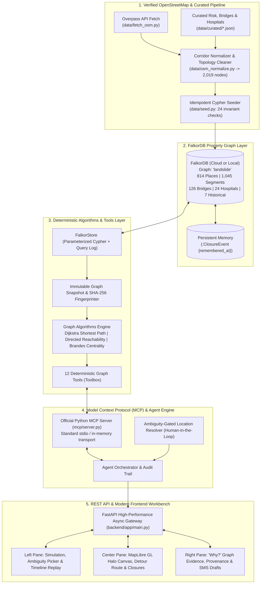

<div align="center">

# 🏔️ Landslide Router
### Graph-Native Mountain Corridor Resilience & Disaster Routing Workbench

[](https://falkordb.com)
[](https://modelcontextprotocol.io)
[](https://fastapi.tiangolo.com)
[](https://maplibre.org)
[](https://docs.pytest.org)
[](https://www.openstreetmap.org)

<p align="center">
  <strong>Sub-second topological rerouting, cascading settlement isolation modeling, and community emergency alert drafting.</strong><br/>
  Engineered specifically for the vulnerable <strong>NH29 Dimapur–Kohima corridor in Nagaland, Northeast India</strong>.
</p>

> ⚠️ **Safety & Operational Scope**: *Landslide Router is a strategic decision-support workbench and disaster planning aid, not an automated emergency dispatch service. All route recommendations and risk estimates are synthesized from OpenStreetMap network topology, historical monsoon incident records, and deterministic graph calculations. Always verify road conditions with local district administration, disaster management authorities, and the Border Roads Organisation (BRO) before travel.*

---


</div>

---

## ⚡ The Problem: Why Ordinary GPS Fails in Disaster Zones

During the June–September South Asian monsoon, intense precipitation triggers recurring landslides, mudslides, and rockfalls along **National Highway 29 (NH29)**—the critical arterial lifeline connecting the Brahmaputra valley at **Dimapur** to the hill capital **Kohima** and the wider Indo-Myanmar frontier.

When a landslide strikes a mountain highway, conventional navigation apps fail emergency planners:

| Operational Dimension | Conventional Consumer Navigation (Google Maps, Waze, Apple Maps) | Landslide Router (Graph-Native Infrastructure Workbench) |
|---|---|---|
| **Core Paradigm** | Point-to-point individual vehicle route speed optimization. | **Systemic network resilience**, topological survivability & regional access equity. |
| **Network Data Model** | Closed proprietary routing graph updated asynchronously via mobile fleet GPS pings. | **FalkorDB Property Graph** with `2,019` real OpenStreetMap nodes, `4,177` relationships, and verified highway attributes. |
| **Location Disambiguation** | Requires exact GPS coordinate or pin; crashes or guesses on vague text. | **Ambiguity-Gated Location Resolver**: Disambiguates natural-language reports (e.g., *"km 42"*), presents candidates, and prevents blind graph mutation. |
| **Cascading Isolation Impact** | Blind to stranded villages behind a blockage if no driver requested routing there. | **Directed BFS Component Analysis**: Immediately flags cut-off settlements (`Kezo Town`, `Kikruma`, `Chakhabama`) and identifies baseline islands. |
| **Critical Healthcare Access** | Silently returns *"No Route Found"*; zero regional healthcare awareness. | **Hospital Reachability Matrix**: Evaluates access across all `24` regional trauma centers and hospitals for isolated communities in real time. |
| **AI Agent Integration** | Unstructured web search scraping or hallucinated LLM coordinates. | **12 Deterministic MCP Tools**: Model Context Protocol standard over `stdio` or in-memory transport with strict schema validation. |
| **Emergency Communications** | None. Incident response teams must draft manual advisories by hand. | **Automated Community SMS Draft Engine**: Instant zero-PII advisory drafting with one-click plain text and JSON export for response teams. |
| **State Verification & Audit** | Ephemeral, opaque state; no ability to verify network restoration. | **Cryptographic State Fingerprints (SHA-256)**: Verifies exact graph restoration to baseline upon closure resolution. |

---

## 🏛️ System Architecture

Landslide Router couples **FalkorDB**'s low-latency Cypher graph query engine with an official **Model Context Protocol (MCP)** server, a **FastAPI** REST orchestrator, and an interactive **React 19 + MapLibre GL** workbench:



---

## 🚀 Key Platform Capabilities

### 1. ⚡ High-Performance FalkorDB Graph Engine
- **Corridor Topology**: Models `814` places (`93` villages, `10` towns, `711` junctions), `1,045` road segments (`294` on NH29 covering `189.52 km`), `126` bridges, and `24` hospitals in **FalkorDB**.
- **Real-Time Cypher Queries**: Computes weighted paths, BFS subgraphs, and dynamic relationship updates in milliseconds without blocking the event loop.
- **Idempotent Seeding**: Graph seeder verifies `0` duplicate nodes and validates all 24 structural invariant tests on every deployment.

### 2. 🤖 12 Deterministic Model Context Protocol (MCP) Tools
All graph analysis is exposed via the official standard Python MCP SDK (`mcp/server.py`):
- `apply_closure`: Creates verified `:ClosureEvent` nodes and dynamic `[:BLOCKS]` relationships.
- `clear_closure`: Resolves active events and archives timestamped historical records.
- `audit_closure`: Verifies complete baseline recovery against SHA-256 graph fingerprints.
- `find_cut_off_places`: Detects villages and towns newly isolated from the reference hub (Dimapur).
- `find_unreachable_hospitals`: Computes reachability matrices across all 24 corridor medical facilities.
- `reroute`: Computes Dijkstra minimum-travel-time alternative paths avoiding active closures.
- `explain_path`: Generates transparent per-segment travel time shares and comparison diffs.
- `find_weak_links`: Computes Brandes all-pairs shortest-path betweenness centrality for every segment and bridge.
- `seasonal_risk`: Ranks critical infrastructure vulnerability by combining monsoon exposure with historical failure logs.
- `draft_alerts`: Synthesizes zero-PII emergency advisory drafts for isolated communities.
- `remember_closure`: Persists simulated incidents into institutional historical memory.
- `probe_capabilities`: Reports active graph metadata, node counts, and operational parameters.

### 3. 🛡️ Ambiguity-Gated Location Disambiguation
Natural-language incident reports often refer to vague landmarks (e.g., *"Landslide at NH29 near kilometre 42"*). Rather than hallucinating coordinates or guessing, Landslide Router's resolver:
- Identifies candidate segments matching highway references, bridge tags, or landmark nodes.
- Flags ambiguous reports with `requires_clarification: true`.
- Renders an inline **Candidate Picker** in the UI, requiring human operator confirmation before any graph mutation occurs.

### 4. 🏥 Systemic Isolation & Hospital Access Matrix
A blockage on a mountain road does not just cause delays—it can cut off access to emergency medical care. When a closure is simulated:
- Evaluates directed reachability from Dimapur to all `814` places.
- Segregates pre-existing disconnected baseline nodes so operators only see **newly attributed isolation**.
- Evaluates travel times from every cut-off village to all `24` hospitals in the corridor.
- Flags facilities with no usable road route remaining.

### 5. 📱 Automated Community SMS Alert Engine (Zero-PII)
- Automatically synthesizes tailored, plain-language emergency broadcast drafts for every isolated village.
- Strictly offline, privacy-preserving, and non-dispatching (`status="draft"`, `sent=false`).
- One-click copy and export to formatted plain-text (`.txt`) and structured JSON for incident command centers.

### 6. ⏪ Timeline Replay & Cryptographic Baseline Audit
- Every simulated and historical closure is permanently recorded in the timeline.
- Operators can click **Replay** on any past disaster (such as the August 2024 Dzüza landslide) to inspect historic detours and hospital impact.
- Upon resolution, the audit engine runs cryptographic checks to ensure that zero phantom closures remain in the graph and the network has returned to baseline.

---

## 🛠️ Quickstart Guide

### Prerequisites
- **Python 3.11+**
- **Node.js 20 LTS+**
- **FalkorDB**: Free **FalkorDB Cloud** database (recommended for zero local container overhead) or local **Docker**.

### 1. Clone & Configure Environment
```bash
git clone https://github.com/NOBA235/LS-Router.git
cd LS-Router/Ls-Router
copy .env.example .env
```

Edit `.env` with your FalkorDB connection settings:
```ini
FALKORDB_HOST=your-falkordb-cloud-endpoint.falkordb.cloud
FALKORDB_PORT=6379
FALKORDB_USERNAME=default
FALKORDB_PASSWORD=your-secure-password
FALKORDB_SSL=false
FALKORDB_GRAPH=landslide
```

### 2. Seed the NH29 Corridor Graph
The validated OpenStreetMap NH29 dataset is included in `data/cache/normalized.json`:
```bash
cd backend
py -3 -m venv .venv
.venv\Scripts\activate.bat
pip install -r requirements.txt
cd ..
python data\seed.py
```
*(Idempotent seeder: verifies that `0` duplicate nodes are created and all 24 invariant checks pass.)*

### 3. Launch the Backend & Interactive Workbench

**Terminal 1 — FastAPI Backend (`http://127.0.0.1:8000`)**:
```bash
cd backend
.venv\Scripts\activate.bat
uvicorn app.main:app --host 127.0.0.1 --port 8000 --reload
```

**Terminal 2 — React 19 + MapLibre Workbench (`http://localhost:5173`)**:
```bash
cd frontend
npm install
npm run dev
```

Open **`http://localhost:5173`** in your browser. Interactive OpenAPI documentation is accessible at **`http://127.0.0.1:8000/docs`**.

---

## 🧪 Testing & Verification

Run the full automated test suite (unit tests, real-graph integration checks, and MCP tool verification):

```bash
cd backend
.venv\Scripts\activate.bat

# Run the end-to-end corridor test suite:
python ..\scripts\run_demo.py

# Run the full pytest suite:
pytest -v
```

**Current Verification Status**:
- ✅ `123 passed, 20 skipped in 7.82s`
- ✅ Idempotent FalkorDB seeder verified (`0 duplicates, 24 invariants passing`)
- ✅ TypeScript frontend build passes without warnings (`npx tsc --noEmit`)

---

## 📄 License & Open-Source Integrity

Distributed under the **Apache-2.0 License**. See `LICENSE` for details.

Developed for community resilience, academic research, and disaster risk reduction in mountainous corridors.

---

<div align="center">
  <sub>Built with ❤️ for the communities of Kohima, Dimapur, and Nagaland. Powered by FalkorDB & Model Context Protocol.</sub>
</div>

